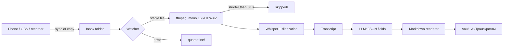

# Voice Notes Pipeline

Turn voice recordings into structured Obsidian notes — locally, on a schedule, without a subscription.

Audio is transcribed by Whisper on your machine. The transcript is then summarized into a structured note (personal note or work meeting), tagged, and written into a vault. A watcher can process new files automatically; failures are isolated instead of looping forever.

> **Scope.** This is a personal automation tool, not a SaaS product. It is good at turning clear speech into a useful draft. It cannot fix a bad recording, and a small local model produces noticeably weaker summaries than a cloud one.

## Why

Voice memos and meeting recordings pile up because rewriting them by hand is boring. Existing tools either upload raw audio to a third party or produce a wall of text without structure. This project keeps the expensive part (transcription) local and makes the note structure deterministic.

## Features

- **Two profiles:** `personal` (thoughts, ideas, diaries) and `work` (meetings, decisions, tasks).
- **Local transcription:** Faster-Whisper-XXL, CUDA, optional speaker diarization.
- **Structured output:** the LLM fills a JSON schema; Markdown is rendered by code. Empty sections, stray tags and broken formatting cannot happen.
- **Providers:** local Ollama *or* any OpenAI-compatible API. Cloud is preferred when configured; local is the fallback.
- **Watcher:** waits for files to stop growing, moves results to `processed/YYYY-MM`, short files to `skipped/`, failures to `quarantine/`.
- **Long recordings:** map-reduce over chunks with batched merging, so a three-hour meeting does not overflow the context.
- **Quality harness:** synthetic fixtures to compare prompts and models without touching a real vault.
- **No magic:** standard library only, plain Markdown output, readable logs.

## Architecture



The same flow is available as a one-shot CLI without the watcher.

## Quick start

Requirements:

- Python 3.10+
- [Faster-Whisper-XXL](https://github.com/Purfview/whisper-standalone-win) (Windows) with CUDA, or any `faster-whisper` CLI you can point to
- ffmpeg
- Ollama with a chat model, **or** an API key for an OpenAI-compatible provider

```bash
git clone https://github.com/<you>/voice-notes-pipeline.git
cd voice-notes-pipeline
python -m venv .venv
.venv\Scripts\activate          # Windows
pip install -e .[dev]

copy .env.example .env          # then edit paths and provider
```

Process one file:

```bash
voice-notes path\to\recording.mp3 --profile work
```

Run the watcher:

```bash
voice-notes-watch
```

Short recordings are skipped by default. Override for a single file:

```bash
voice-notes path\to\short.m4a --allow-short
```

## Configuration

Everything lives in `.env` (see `.env.example`).

| Variable | Meaning |
|---|---|
| `VAULT_PERSONAL`, `VAULT_WORK` | Obsidian vaults for each profile |
| `INBOX_PERSONAL`, `INBOX_WORK` | Folders the watcher polls |
| `WHISPER_DIR` | Folder containing `faster-whisper-xxl.exe`, `ffmpeg.exe`, `postprocess.py` |
| `WHISPER_MODEL` | `large-v3-turbo` (fast) or `large-v3` (more accurate, ~3× slower) |
| `LLM_PROVIDER` | `local` or `cloud` |
| `LOCAL_MODEL`, `OLLAMA_URL` | Local fallback |
| `LLM_API_BASE`, `LLM_API_KEY`, `LLM_MODEL` | OpenAI-compatible endpoint |
| `MIN_DURATION_SEC` | Files shorter than this go to `skipped/` (default 60) |

See [docs/PROVIDERS.md](docs/PROVIDERS.md) for endpoint examples and model notes.

## What a note looks like

Work profile, generated from the synthetic fixture in `eval/fixtures/meeting.txt`:

```markdown
## Суть
Обсудили перенос дедлайна из-за незавершённой интеграции с оплатой.
Демо клиенту — в четверг в 10 утра, сервер — более дорогой тариф с бэкапами.

## Ключевое по темам
### Перенос дедлайна
- Дедлайн перенесён на пятницу из-за незавершённой интеграции с оплатой.
- Интеграцией занимается Миша, ему нужно два дня.

## Решения и обоснования
- Перенос дедлайна на пятницу. — Интеграция с оплатой ещё не готова.

## Задачи
- [ ] Завершить интеграцию с оплатой. — Миша, срок: через два дня

#проект #дедлайн #оплата #сервер #демо
```

Full examples: [work](examples/sample-work-note.md), [personal](examples/sample-personal-note.md). The real note also appends the full transcript inside a collapsed `<details>` block.

## Design decisions

Short version; details in [docs/DECISIONS.md](docs/DECISIONS.md).

- **JSON in, Markdown out.** Asking a small model to "write clean Markdown" fails: it invents headings, puts tags in the middle and leaves empty sections. Schemas plus a renderer remove that class of bugs entirely.
- **Non-empty SRT beats exit code.** Faster-Whisper-XXL can crash after writing subtitles while reading a broken mp3 header. The pipeline treats a valid SRT as success.
- **Normalize before transcribing.** Phone recordings have broken headers and non-breaking spaces in filenames; staging and ffmpeg conversion fix both.
- **Quarantine after the first failure.** Otherwise a broken file is retried every 20 seconds forever.
- **Unload the local LLM before Whisper.** Whisper and a 7B model do not fit into 8 GB of VRAM together; without this, diarization fails with a CUDA error.
- **Cloud fallback, not cloud dependency.** A failed API call falls back to the local model so a recording is never lost.

## Quality and limitations

Honest numbers from development on a 5-minute clear meeting, a 2-minute idea, and a 3-hour emotional dialogue:

| Input | Local 7B | Cloud (GPT-4.1-mini) |
|---|---|---|
| Clear meeting | usable, 8/10 | usable, 9/10 |
| Short idea | loses the "why", 6/10 | keeps specifics, 8/10 |
| 3-hour rambling dialogue | generic retelling, 3/10 | coherent summary with numbers, 7/10 |

What does not work regardless of the model: noisy streams and poor ASR. Garbage in, confident garbage out. The pipeline mitigates this by dropping unreadable fragments, but it cannot reconstruct what was never recognized.

The local `qwen2.5:7b` mostly extracts facts; it is weak at abstraction and occasionally invents plausible actions. That is why cloud is a first-class option here, not an afterthought.

## Project layout

```
src/voice_notes/
  config.py       env-based configuration
  transcribe.py   ffmpeg, duration, Whisper, speaker labels
  providers.py    local Ollama + OpenAI-compatible cloud
  schemas.py      JSON schemas for structured output
  prompts.py      prompt templates (Russian)
  render.py       deterministic Markdown
  summarize.py    chunking, map-reduce, profile dispatch
  notes.py        vault writer
  watcher.py      inbox loop, processed/quarantine/skipped
  cli.py          one-shot command
tests/            unit tests, no GPU or network
eval/             fixtures and a quality harness
docs/             architecture, decisions, Windows setup, providers
```

## Tests

```bash
pip install -e .[dev]
ruff check .
pytest
```

Tests cover rendering, tag normalization, speaker labels, duration math and JSON parsing. Nothing requires a GPU, network or API key.

## Roadmap

- [ ] Pluggable transcription backends (whisper.cpp, cloud Whisper)
- [ ] Per-profile prompt overrides in `.env`
- [ ] Optional YAML frontmatter for Dataview queries
- [ ] Retry policy with exponential backoff for cloud providers
- [ ] Linux/macOS setup guide

## License

MIT. See [LICENSE](LICENSE).

---

## По-русски

Пайплайн для голосовых заметок: запись → локальная расшифровка Whisper → структурированная заметка → Obsidian. Аудио остаётся на компьютере; в облако (если включено) уходит только текст транскрипта.

Два профиля: `personal` (мысли и идеи) и `work` (созвоны: решения, задачи, ответственные). Вотчер сам обрабатывает новые файлы, короткие записи складывает в `skipped/`, ошибки — в `quarantine/`.

Модель заполняет JSON-поля, а Markdown собирает код — поэтому в заметках не бывает пустых разделов, тегов не на месте и мусорной разметки.

Честно об ограничениях: на чистой речи результат хороший, на плохом распознавании — нет. Локальная 7B слабее облачной модели, поэтому облачный провайдер поддерживается как основной вариант, а локальный — как резерв.

Быстрый старт, конфигурация и примеры — выше. Подробности по установке на Windows: [docs/SETUP-WINDOWS.md](docs/SETUP-WINDOWS.md).
